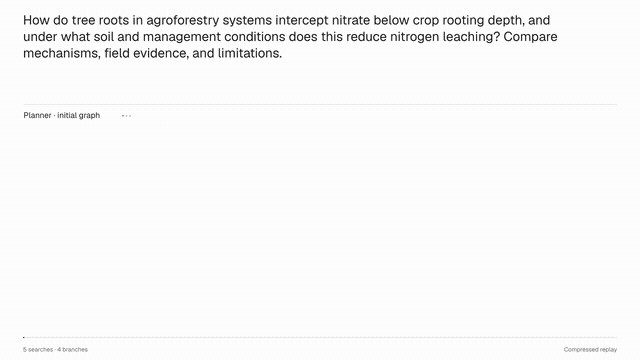
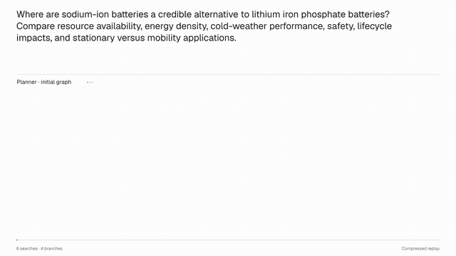
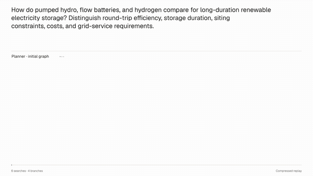

# DecomposeR

Planner-centric reinforcement learning for deep research with structure-aware
reward. Official code and research artifacts for our paper in
*Transactions on Machine Learning Research* (TMLR), 2026.

DecomposeR first plans a typed research graph, searches the web, revises the
graph once and chooses pages to fetch. It then writes evidence-grounded branch
reports in dependency order and synthesizes the final report. The released
checkpoint is a **merged Qwen3-8B model** used in both roles. The individual
planner and answerer LoRA adapters are also available below; the answerer was
trained on top of the merged planner checkpoint.

## Research demonstrations

[Explore interactive planner–answerer demonstrations](https://mustafaah10.github.io/DecomposeR/#research-viewer).
Each 20-second replay shows a real saved rollout: planning, search, revision,
branch reports written in the same execution wave, and final synthesis. The
animations compress timing; they are not recordings of streamed tokens.

### Tree roots and nitrogen leaching

[](https://mustafaah10.github.io/DecomposeR/#research-viewer)

[Click here](https://mustafaah10.github.io/DecomposeR/#research-viewer)

### Sodium-ion batteries

[](https://mustafaah10.github.io/DecomposeR/#research-viewer)

[Click here](https://mustafaah10.github.io/DecomposeR/#research-viewer)

### Long-duration energy storage

[](https://mustafaah10.github.io/DecomposeR/#research-viewer)

[Click here](https://mustafaah10.github.io/DecomposeR/#research-viewer)

Explore the demonstrations on the project page, with video replays, clickable
graph nodes, node-to-node navigation, source links, and complete model reports.

## Start here

| Task | Location |
|---|---|
| Inspect saved benchmark reports and graphs without a GPU | `artifacts/evaluation/` |
| Run benchmark generation and grading | [Benchmark evaluation](#benchmark-evaluation) |
| Reproduce the HealthBench subset without a model or API keys | [Subset preparation](#reproduce-the-healthbench-subset) |
| Generate new research reports | `demo/scripts/run_demo.sh` |
| Read the exact planner and answerer instructions | `decomposer_v4/prompts/` |
| Inspect training queries and RL rubrics | `artifacts/training_data/` |
| Review artifact coverage and provenance | `docs/RELEASE_AUDIT.md` |
| Read the original submitted documentation | `docs/SUBMITTED_README.md` |

## Layout

```text
decomposer_v4/         Submitted pipeline, prompts, configurations and evaluators
verl/                 Vendored training framework, with upstream license notices
artifacts/
  training_data/      2,325 SFT queries; 1,432 RL queries with rubrics
  evaluation/         100 DRBench, 500 HealthBench and 776 ResearchQA trajectories
docs/                 Artifact provenance and archived submission documentation
demo/                 Demonstrations and repository presentation tools
  examples/           Demonstration questions
  scripts/            Demo generation and release-validation utilities
  showcase/           Video examples, animated previews and viewer source
```

The benchmark trajectories are lean: they preserve graphs, model outputs,
citations and timing, but omit full retrieved web-page content. These are
final-model artifacts, not a complete archive of all baselines, seeds or
ablations. DeepResearchBench includes aggregate RACE/FACT summaries rather
than per-item grader traces. Training queries are not full SFT completions.

## 🤗 Hugging Face models and adapters

| Model or adapter | Download | Usage |
|---|---|---|
| **Merged DecomposeR Qwen3-8B** | [🤗 Hugging Face](https://huggingface.co/mustafaah/qwen3-8b-decomposer-v4-planner-answerer-rl-step358-merged) | Ready-to-use planner–answerer model; used by the demo. |
| **SFT model** | [🤗 Hugging Face](https://huggingface.co/mustafaah/qwen3-8b-decomposer-SFTeval) | SFT checkpoint used as the base for planner RL training. |
| **Planner LoRA adapter** | [🤗 Hugging Face](https://huggingface.co/mustafaah/qwen3-8b-decomposer-v4-planner-rl-step300-lora) | Planner RL adapter, applied to the merged SFT checkpoint. |
| **Answerer LoRA adapter** | [🤗 Hugging Face](https://huggingface.co/mustafaah/qwen3-8b-decomposer-v4-answerer-rl-step358-lora) | Answerer RL adapter, trained on top of the merged planner checkpoint. |

The answerer adapter was trained on top of the SFT model with the planner
adapter merged into it. The training sequence is: SFT model → planner LoRA
training and merge → answerer LoRA training and merge.
Use the final merged model above for inference without loading adapters separately.

For the new demonstrations, pin revision
`503e2bb12418b22259c0196700d3b0587ea00d42`. The checkpoint is public; a
Hugging Face token is not normally needed to download it.

Use a compatible CUDA/vLLM environment, then install the small inference overlay:

```bash
python3 -m pip install -r requirements-inference.txt
export JINA_API_KEY=...      # Search queries, up to five results per node
export SERPER_API_KEY=...    # Fetch selected URLs, at most four per revision
bash demo/scripts/run_demo.sh
```

The complete demonstration run uses a 96 GB GPU. The script does not rent
hardware. Credentials stay in the process environment, never in Git or the
browser. OpenAI, Gemini, Exa, DeepSeek and W&B credentials are not required to
generate the demonstrations. Benchmark grading is a separate paid step.

## Benchmark evaluation

Evaluation runners for all three benchmarks live in `decomposer_v4/eval/`.
The `demo/` folder contains demonstration and repository presentation tools.

| Benchmark | Evaluation set | Runner |
|---|---|---|
| DeepResearchBench | All 100 queries, English and Chinese | `decomposer_v4/eval/run_deep_research_bench_full_eval.sh` |
| ResearchQA-Mini | Full `test_mini` split, 776 queries | `decomposer_v4/eval/ResearchQA/run_researchqa_mini_final_8b.sh` |
| HealthBench | 500 sampled examples, 20% from the hard split, seed 17 | `decomposer_v4/eval/run_healthbench_eval.sh` |

Only HealthBench needs the custom subset-selection step described below.
Saved queries and final-model outputs for all three benchmarks are included in
`artifacts/evaluation/` for inspection without rerunning inference.

### Generate and grade benchmark reports

Run from the repository root in a compatible CUDA/vLLM environment. Install
both inference and evaluation dependencies, select the merged model, and set
the retrieval and grading credentials:

```bash
python3 -m pip install -r requirements-inference.txt -r decomposer_v4/eval/requirements_eval.txt
export MODEL=mustafaah/qwen3-8b-decomposer-v4-planner-answerer-rl-step358-merged
export JINA_API_KEY=...
export SERPER_API_KEY=...
export OPENAI_API_KEY=...
```

Run the desired benchmark:

```bash
# HealthBench: prepare the subset, generate reports, and grade.
bash decomposer_v4/eval/run_healthbench_eval.sh

# ResearchQA-Mini: download the split, generate reports, and grade coverage.
bash decomposer_v4/eval/ResearchQA/run_researchqa_mini_final_8b.sh

# DeepResearchBench: prepare language splits, generate reports, and run RACE/FACT.
# Requires a separately installed evaluator checkout (see below).
DRB_DIR=deep_research_bench bash decomposer_v4/eval/run_deep_research_bench_full_eval.sh
```

DeepResearchBench's evaluator is not bundled. Install its dependencies and
configure its judge models and API credentials in a separate checkout at
`deep_research_bench/`, or set `DRB_DIR` to that checkout's path. The runner
expects `data/prompt_data/query.jsonl`, `deepresearch_bench_race.py`, and the
FACT `utils` modules there. It evaluates English, Chinese, and combined outputs;
judge configuration is managed by that external evaluator.

HealthBench defaults to grader `gpt-4.1-2025-04-14`; ResearchQA-Mini defaults to
coverage grader `gpt-4.1-mini`. Set `RUN_GRADE=0` or `RUN_COVERAGE=0`, respectively,
to generate reports without grading. Generation requires model inference and
retrieval access; grading makes paid API calls.

HealthBench and ResearchQA outputs are written under `outputs/eval/healthbench/`
and `outputs/eval/researchqa/`. DeepResearchBench trajectories are written under
`outputs/eval/deep_research_bench/`, with generated reports and scores in the
external evaluator's `data/test_data/raw_data/` and `results/` directories.
These commands rerun the pipeline; live retrieval and judge responses can
produce different scores from the saved paper artifacts.

## Reproduce the HealthBench subset

This preparation step needs only Python and PyYAML, not a GPU, model or API key.
Run from this repository's root:

```bash
python3 -m venv .venv
source .venv/bin/activate
python3 -m pip install PyYAML
python3 decomposer_v4/eval/prepare_healthbench_queries.py \
  --subset all --sample 500 --hard-fraction 0.2 --seed 17 \
  --output-path outputs/hb_queries.jsonl \
  --selected-healthbench-output-path outputs/hb_selected.jsonl \
  --summary-json outputs/hb_summary.json
```

The first invocation downloads the official dataset and may take several
minutes. To use previously downloaded files, supply `--input-path` and
`--hard-input-path`. Compare the selected IDs with
`artifacts/evaluation/healthbench/selected_prompt_ids.txt`.

## Scope and limitations

Graph validation, successful execution and well-formed citations do not prove
that every generated claim is correct. Inspect underlying sources before using
reports for consequential decisions. New showcase queries are demonstrations,
not additional benchmark measurements.

The top-level `requirements.txt` retains the submitted training dependencies.
Do not install that full stack merely to inspect saved results or prepare a
subset. Full training also requires teacher completions/prepared evidence not
included in this query-only data release.

## Citation

DecomposeR accompanies the paper *DecomposeR: Planner-Centric Reinforcement
Learning for Deep Research with Structure-Aware Reward* (Hussain, Wu, and Lu,
Transactions on Machine Learning Research, 2026;
[OpenReview](https://openreview.net/forum?id=qG4deYtMxL)). If you use DecomposeR
in your research, please cite it using the metadata in [`CITATION.cff`](CITATION.cff),
or:

```bibtex
@article{hussain2026decomposer,
  title   = {{DecomposeR}: Planner-Centric Reinforcement Learning for Deep Research with Structure-Aware Reward},
  author  = {Hussain, Mustafa Anis and Wu, Xinle and Lu, Yao},
  journal = {Transactions on Machine Learning Research},
  issn    = {2835-8856},
  year    = {2026},
  url     = {https://openreview.net/forum?id=qG4deYtMxL}
}
```

## License

Original DecomposeR code is licensed under [Apache-2.0](LICENSE).
Third-party components retain their respective licenses, including
[VERL](verl/LICENSE), [simple-evals](decomposer_v4/eval/simple-evals/LICENSE),
and the [Geist fonts](demo/showcase/viewer/embed/fonts/OFL.txt).
Benchmark data and cited web content retain their upstream terms.
